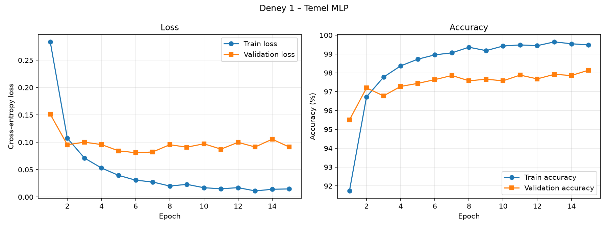
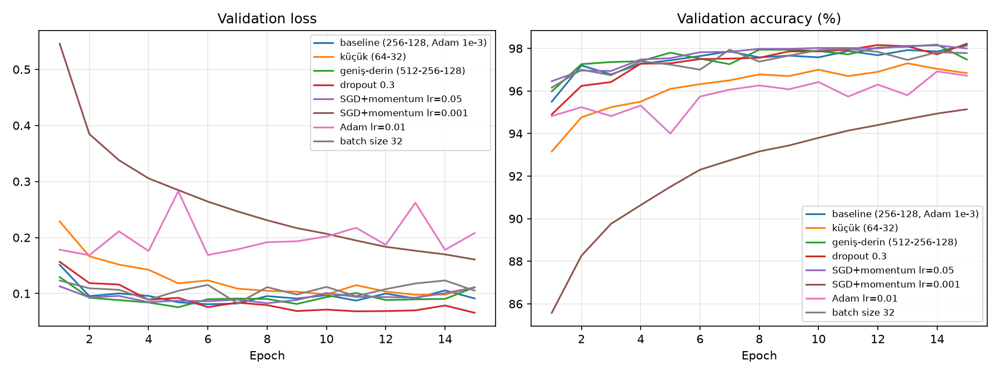
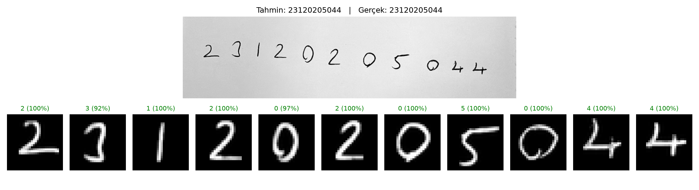

# MNIST ile MLP Tabanlı El Yazısı Rakam Tanıma

Bu projede MNIST veri seti üzerinde **sıfırdan** bir Multi-Layer Perceptron (MLP) eğitilmiş, farklı model
yapılandırmaları karşılaştırılmış ve model, kendi el yazımla yazdığım öğrenci numaram üzerinde test edilmiştir.
CNN veya önceden eğitilmiş model kullanılmamıştır. Kütüphane: **PyTorch**.

## Proje Yapısı

```
├── experiment1.py           # Deney 1 – Temel MLP (eğitim + test + grafikler)
├── compare_experiments.py   # Hiperparametre / mimari karşılaştırması
├── predict_handwriting.py   # Kendi el yazısı görüntülerinde tahmin
├── src/
│   ├── model.py             # MLP sınıfı
│   ├── data.py              # MNIST yükleme, train/val/test ayrımı, normalizasyon
│   ├── train.py             # Eğitim / değerlendirme döngüsü
│   ├── preprocess.py        # El yazısı görüntülerini MNIST formatına çevirme
│   └── plots.py             # Loss / accuracy grafikleri
├── handwriting/
│   ├── raw/                 # Kendi el yazımla öğrenci numaram (orijinal fotoğraf)
│   └── processed/           # MNIST formatına getirilmiş 28x28 rakamlar
└── results/                 # Model ağırlıkları, JSON özetler, grafikler
```

## Kurulum ve Çalıştırma

```bash
python3 -m venv .venv && source .venv/bin/activate
pip install -r requirements.txt

python experiment1.py                 # Deney 1 (MNIST otomatik indirilir)
python compare_experiments.py         # Karşılaştırmalı deneyler
python predict_handwriting.py handwriting/raw/ogrenci_no.jpg --expected <OGRENCI_NO>
```

Tüm deneyler `seed=42` ile tekrarlanabilirdir.

## Veri Seti ve Train / Validation / Test Ayrımı

| Küme | Örnek sayısı | Kaynak | Kullanım |
|---|---|---|---|
| Train | 55.000 | MNIST eğitim kümesinin rastgele (seed=42) %91.7'si | Ağırlıkların güncellenmesi |
| Validation | 5.000 | MNIST eğitim kümesinden ayrılan kısım | Epoch takibi, en iyi epoch ve hiperparametre seçimi |
| Test | 10.000 | MNIST'in resmi test kümesi | **Yalnızca eğitim bittikten sonra bir kez** |

- Normalizasyon: piksel değerleri `[0,1]` aralığına getirilip `(x − mean) / std` uygulanmıştır.
  `mean = 0.1307`, `std = 0.3081` değerleri **yalnızca train kısmından** hesaplanmıştır
  (`results/normalization.json`).
- Test kümesi model geliştirme sürecinde hiçbir karar için kullanılmamıştır; en iyi model validation
  doğruluğuna göre seçilmiş, test doğruluğu sadece raporlanmıştır.

## Deney 1 – Temel MLP Modeli

### Mimari

```
Girdi (28x28) → Flatten (784)
→ Linear(784, 256) → ReLU
→ Linear(256, 128) → ReLU
→ Linear(128, 10)  → (softmax, CrossEntropyLoss içinde)
Toplam eğitilebilir parametre: 235.146
```

### Hiperparametreler

| Hiperparametre | Değer |
|---|---|
| Hidden layer sayısı / boyutları | 2 / [256, 128] |
| Aktivasyon | ReLU |
| Loss | Cross-Entropy |
| Optimizer | Adam |
| Learning rate | 0.001 |
| Batch size | 128 |
| Epoch | 15 |
| Dropout / Weight decay | 0 / 0 |
| Ağırlık başlatma | PyTorch varsayılanı (Kaiming-uniform) |
| Donanım | CPU (Apple Silicon) |

### Sonuçlar

| Metrik | Değer |
|---|---|
| Training loss (son epoch) | 0.0148 |
| Validation loss (son epoch) | 0.0913 |
| Training accuracy (son epoch) | %99.48 |
| Validation accuracy (en iyi, epoch 15) | %98.14 |
| **Test accuracy** | **%98.00** (test loss 0.0963) |
| Eğitim süresi (15 epoch) | ≈ 6.2 s (~0.4 s/epoch) |



**Yorum:** Train loss sürekli düşerken validation loss yaklaşık 6. epoch'tan sonra ~0.08–0.10 bandında
dalgalanmaya başlamıştır. Train accuracy %99.5'e çıkarken validation accuracy %98 civarında kalmaktadır.
Bu ~1.5 puanlık fark, modelin eğitim verisini ezberlemeye başladığını (hafif **overfitting**) gösterir.
Validation accuracy yine de artmaya devam ettiği için en iyi model son epoch olmuştur.

## Karşılaştırmalı Deneyler (Hiperparametre Etkisi)

Tüm deneylerde aynı veri ayrımı ve seed kullanılmış, yalnızca belirtilen değer değiştirilmiştir (15 epoch).

| Deney | Param | Train loss | Val loss | Train acc | Val acc (en iyi) | Test acc | Süre (s) |
|---|---|---|---|---|---|---|---|
| Baseline (256-128, Adam 1e-3, bs 128) | 235.146 | 0.0148 | 0.0913 | %99.48 | %98.14 | %98.00 | 6.3 |
| Küçük ağ (64-32) | 52.650 | 0.0274 | 0.1110 | %99.10 | %97.30 | %97.43 | 4.9 |
| Geniş-derin ağ (512-256-128) | 567.434 | 0.0142 | 0.1113 | %99.52 | %98.18 | %97.99 | 10.0 |
| Dropout 0.3 | 235.146 | 0.0480 | 0.0657 | %98.46 | %98.22 | %98.21 | 7.5 |
| SGD + momentum 0.9, lr = 0.05 | 235.146 | 0.0047 | 0.1109 | %99.84 | %98.14 | %98.20 | 5.0 |
| SGD + momentum 0.9, lr = 0.001 | 235.146 | 0.1407 | 0.1608 | %96.03 | %95.14 | %95.77 | 5.0 |
| Adam, lr = 0.01 | 235.146 | 0.0820 | 0.2079 | %98.00 | %96.92 | %96.66 | 6.3 |
| Batch size 32 | 235.146 | 0.0169 | 0.1051 | %99.50 | %97.98 | %97.92 | 16.5 |



**Gözlemler:**
- **Model kapasitesi:** 64-32'lik küçük ağ ~0.7 puan geride kalmıştır. Parametre sayısını 2.4 katına
  çıkaran 3 katmanlı geniş ağ ise test doğruluğunu artırmamış, sadece eğitimi yavaşlatmış ve validation
  loss'u yükseltmiştir (daha fazla overfitting). MNIST için 256-128 yeterli kapasitededir.
- **Dropout (0.3):** Train accuracy düşmesine rağmen en düşük validation loss'u (0.066) ve en yüksek
  test doğruluğunu (%98.21) vermiştir. Train-val farkı neredeyse kapanmıştır. Regularization
  overfitting'i azaltmıştır.
- **Learning rate:** En hassas hiperparametre budur. SGD'de lr = 0.001, 15 epoch'ta yakınsamaya
  yetmemiştir (%95.8, underfitting). lr = 0.05 ise Adam ile aynı seviyeye ulaşmıştır. Adam'da lr = 0.01
  çok büyük kalmış, eğitim kararsızlaşmış ve validation loss 2 katından fazla artmıştır.
- **Optimizer:** Uygun lr seçildiğinde SGD+momentum ve Adam benzer sonuç vermiştir. Adam varsayılan lr ile
  daha az ayar gerektirmektedir.
- **Batch size:** 32'ye düşürmek doğruluğu değiştirmemiş, epoch başına adım sayısı arttığı için eğitim
  süresini ~2.6 kat uzatmıştır.

> Not: Farklar bazı durumlarda 0.1–0.2 puan düzeyindedir. Tek bir seed ile yapılan deneylerde bu kadar
> küçük farklar rastlantısal olabilir.

## Kendi El Yazısı ile Test

### Görüntülerin hazırlanması (`src/preprocess.py`)

Kendi el yazım, MNIST görüntülerinin hazırlanış biçimine mümkün olduğunca benzetilmiştir:

1. **Gri tonlama:** Fotoğraf tek kanala çevrilir (telefon EXIF yönü düzeltilir).
2. **Renk uyumu:** Kenar piksellerinin medyanı açıksa (beyaz kağıt) görüntü ters çevrilir. Böylece
   MNIST'teki gibi *siyah arka plan, beyaz rakam* elde edilir.
3. **Gürültü temizleme:** Hafif Gauss bulanıklaştırma ve Otsu eşiği ile kağıt dokusu ve gölgeler sıfırlanır,
   mürekkep kontrastı gerilir.
4. **Rakamlara ayırma:** Sütun izdüşümü ile öğrenci numarasındaki rakamlar soldan sağa ayrılır.
5. **Çizgi kalınlığı:** Kalemle yazılmış ince çizgiler, MNIST'teki kalınlığa (20 px kutuda ~2–3 px)
   yaklaştırılmak için genişletilir (max-filter).
6. **Boyutlandırma:** En-boy oranı korunarak uzun kenar **20 piksele** ölçeklenir ve **28×28** siyah tuvale
   yerleştirilir.
7. **Ortalama:** Kütle merkezi görüntünün merkezine kaydırılır (MNIST'in yaptığı gibi).
8. **Normalizasyon:** `[0,1]` aralığı ve eğitimdeki `mean/std` ile standartlaştırma.

### Sonuçlar

Öğrenci numaram beyaz kağıda tükenmez kalemle yazılmış ve telefonla fotoğraflanmıştır
(orijinal: `handwriting/raw/ogrenci_no.jpg`, işlenmiş 28×28 rakamlar: `handwriting/processed/`).

```bash
python predict_handwriting.py handwriting/raw/ogrenci_no.jpg --expected 23120205044
```

| Ön işleme | Model tahmini | Doğru rakam | Notlar |
|---|---|---|---|
| Tam ön işleme (kalınlaştırma dahil) | `23120205044` | **11 / 11 (%100)** | En düşük güven: "3" (%92), ilk "0" (%97) |
| Çizgi kalınlaştırma kapalı (`--no-thicken`) | `23122205044` | 10 / 11 (%90.9) | İlk "0" → **"2"** (güven %49), ikinci "0" sadece %69 güvenle doğru |
| Gerçek | `23120205044` | | |



**Yorum:** Tam ön işleme ile numaramın 11 rakamının tamamı doğru tanınmıştır. Ancak güven değerleri MNIST
test kümesine göre daha düşüktür. Özellikle alt kısmı açık ve düz yazılmış "3" (%92) ile içine çizgi
taşmış ilk "0" (%97) modeli kararsız bırakmıştır. Kalem çizgisini MNIST kalınlığına getiren adım
kapatıldığında, ince çizgili "0" görüntüsü bir "2" ile karıştırılmıştır. Bu deney, ön işlemenin eğitim ve
gerçek veri arasındaki dağılım farkını kapatmadaki rolünü doğrudan göstermektedir.

## Genel Değerlendirme

- İki hidden layer'lı basit bir MLP, MNIST test kümesinde **%98** doğruluğa yaklaşık 6 saniyede ulaşmıştır.
  Dropout ile bu değer **%98.2**'ye çıkmıştır.
- Loss ve accuracy eğrileri, train ile validation arasındaki farkın epoch'lar ilerledikçe açıldığını
  göstermektedir. Bu nedenle validation kümesi hem overfitting'i izlemek hem de en iyi modeli seçmek için
  kullanılmıştır. Test kümesine yalnızca en sonda bakılmıştır.
- Hiperparametreler arasında sonucu en çok etkileyen **learning rate** olmuştur. Model boyutunu artırmanın
  belirli bir noktadan sonra faydası yoktur. Regularization (dropout) genellemeyi iyileştirmiştir.
- **Distribution shift:** MNIST'te rakamlar belirli bir şekilde hazırlanmıştır: ortalanmış, 20×20 kutuya
  ölçeklenmiş, kalın ve düzgün çizgili. Kendi el yazım ise farklı bir dağılımdan gelir: farklı kalem
  kalınlığı, kağıt dokusu, ışık, eğim ve yazım stili. MLP pikselleri konumdan bağımsız olarak
  öğrenemediği için (CNN'deki gibi öteleme değişmezliği yoktur) kaymaya, kalınlık farkına ve ölçek
  farkına karşı hassastır. Bu yüzden ön işleme adımları (ortalama, kalınlaştırma, ters çevirme) başarı
  için kritiktir. Kendi numaramda bu durum açıkça görülmüştür. Tüm adımlarla %100 başarı elde edilmiş,
  yalnızca çizgi kalınlaştırma kapatıldığında ince yazılmış bir "0" "2" olarak tahmin edilmiştir (%49 güven).
- **Sınırlılıklar:** 11 rakamlık bir örnek, gerçek dünya başarısı için istatistiksel olarak küçüktür.
  Rakamların birbirine değdiği, eğik veya farklı stillerde (örn. çizgili 7, kapalı 4) yazılmış görüntülerde
  hata oranı artacaktır. Rakam ayırma adımı da rakamlar arasında boşluk olduğunu varsaymaktadır.
  Data augmentation (öteleme, döndürme, kalınlık değişimi) veya CNN mimarisi bu genellemeyi
  iyileştirebilir. Ancak bu ödevin kapsamı MLP ile sınırlıdır.
